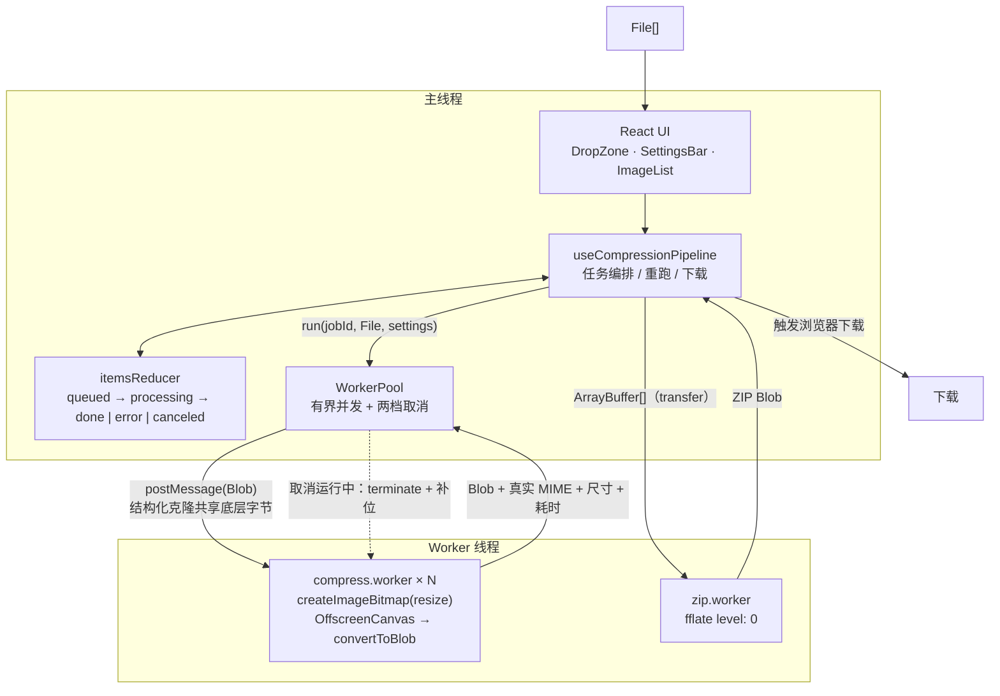

# 图片压缩工作台

纯前端的批量图片压缩工具。拖进来、调参数、打包下载 —— **所有处理都在浏览器里完成，图片不会离开本机**。没有后端、没有上传、没有账号。

**在线演示**：https://image-compression-workbench.pages.dev

React 19 · TypeScript 7 · Vite 8 · Tailwind CSS 4 · Web Worker · OffscreenCanvas

---

## 为什么值得一看

在线压缩工具要把原图上传到别人的服务器；而手机动辄 50 MP 的原图，直接在浏览器主线程解码就会吃掉几百 MB 内存、把页面卡死。这个项目把这两件事都当作硬约束来处理：

- **零网络请求** —— 全仓库没有任何 `fetch` / XHR / 埋点，字体与图标全部内联或本地；
- **解码与编码全部在 Worker 里** —— 主线程只负责状态与合成，滚动和输入始终跟手；
- **大图在解码阶段就缩小** —— 不是解出 192 MB 再缩放，而是让解码器直接按目标尺寸出图。

---

## 核心能力

| 能力 | 实现要点 |
|---|---|
| 批量导入 | 拖拽 / 点选，JPEG / PNG / WebP；`File.type` 为空时按魔数嗅探，不会误拒 Android 相册拖出来的照片 |
| 并行处理 | Worker 池，大小 `min(4, max(2, hardwareConcurrency - 1))`，有界队列先进先出 |
| 两档取消 | 排队中直接出队；运行中 `terminate()` 并**立刻补一个同类型 worker** |
| 压缩与转换 | 质量 0.1–1.0、保持原格式 / 统一 JPEG / 统一 WebP、最大宽高等比缩放 |
| 解码期降采样 | 读文件头预测显示尺寸，用 `createImageBitmap` 的 `resizeWidth/resizeQuality` 直接缩小出图 |
| 方向正确 | 不解析 EXIF 做旋转 —— 交给 `createImageBitmap` 的 `from-image` 语义，避免二次旋转 |
| 编码能力探测 | 4×4 探针，判定标准是 `blob.type === 请求的 MIME`，Safari 上禁用 WebP 并说明原因 |
| 虚拟列表 | 固定行高的窗口化渲染，DOM 行数与列表长度无关 |
| 内存卫生 | 每张图的 `ImageBitmap` 在 `finally` 里 `close()`；缩略图 URL 随行卸载即 `revoke` |
| 打包下载 | fflate 在独立 Worker 里打包（`level: 0`），字节通过 transfer 列表传递 |

---

## 性能

测量环境：Chromium / 16 核（池大小取上限 4）/ 本机 SSD。测试数据的生成与复现方式见 [`docs/performance.md`](docs/performance.md)。

| 场景 | 结果 |
|---|---|
| 48 MP（8000×6000），不设尺寸上限 | 输出 8000×6000，**1474 ms** |
| 48 MP，最大宽 1920 | 输出 1920×1440，**555 ms**（↓62%） |
| 单张解码后位图占用（RGBA 计算值） | 8000×6000 ≈ **192 MB** → 1920×1440 ≈ **11 MB** |
| 300 张 3000×2000，最大宽 1000 | **11–13 s** 全部完成（4 路并发） |
| 300 条列表的 DOM | 行节点 **9–11 个**，页面总节点 275–317 |
| 300 条列表滚动时的存活 objectURL | **等于可见行数**（9–11），不随滚动累积 |
| 质量参数生效性（同一张图，1000×667 JPEG） | q=0.9 → 137 KB；q=0.2 → 33.2 KB |

> 降采样只在「设置了最大宽/高」且文件头可解析时生效 —— 不设上限意味着输出等于原图，全尺寸解码无法避免。

---

## 架构



**数据流**：`File` 以 Blob 的形式结构化克隆进 worker（只复制外壳、共享底层字节，本身是 O(1)），解码、缩放、编码都在 worker 内完成；结果 `Blob` 回到主线程后只用来算体积/压缩率和生成缩略图。真正需要零拷贝的是最后一步：把每个结果的 `ArrayBuffer` 用 transfer 列表交给 zip worker。

---

## 三个真正的坑

这份代码里大部分"看起来多余"的处理，都是为了绕开下面三件事。

### 1. EXIF 会被应用两次

`createImageBitmap` 的规范默认值就是 `imageOrientation: 'from-image'` —— 解码时方向已经烘进像素、宽高也已经交换。如果这时再读 `0x0112` 手动 `ctx.rotate`，Orientation 6/8 的手机照片会转 180°。

更麻烦的是"关掉它"并不现实：`imageOrientation: 'none'` 已从规范中移除，MDN 的兼容数据把它标为所有引擎均未实现，Chrome 只保留它作为废弃别名。

所以这个项目的规则是：**不解析方向、不旋转，绘制的永远是恒等变换**。方向相关的验证用一张"存储 800×400、标称 Orientation=6"的样本，正确输出是 400×800。

### 2. Safari 会把 WebP 静默编成 PNG

canvas 遇到不支持的 MIME **不会抛错**，而是按 PNG 编码。Safari 至今不能从 canvas 编码 WebP，所以请求 `image/webp` 会拿到 `blob.type === 'image/png'` 的结果。如果这时把用户选的 `.webp` 后缀贴上去，交付的就是"后缀 webp、内容 png"的文件。

处理方式：启动时逐个 MIME 跑 4×4 探针，**判定标准只有 `blob.type === 请求的 MIME`**；不可用的格式在 UI 里直接禁用，扩展名与 ZIP 条目名一律从真实的 `blob.type` 派生。

### 3. 内存与取消

- **解码**：50 MP 原图全尺寸解码 ≈ 192 MB 的 RGBA 位图，四个并发就是几个 G。所以设了尺寸上限时，先读 256 KB 文件头（JPEG SOF / PNG IHDR / WebP VP8X）算出目标长边，用 `resizeWidth`/`resizeHeight` + `resizeQuality: 'high'` 让解码器直接缩小出图。**只约束长边**——长边在方向交换前后是同一个数，所以即使头部对方向的判断有偏差，也只会多解一点像素，绝不会少于目标分辨率。
- **释放**：`ImageBitmap.close()` 是唯一能确定性释放位图显存的手段，放在 `finally` 里；画布每个 worker 复用一个。
- **取消**：`createImageBitmap` 与 `convertToBlob` 都不接受 `AbortSignal`，所以运行中的任务只能靠 `terminate()` 停掉 CPU，然后立刻补一个新 worker 维持池容量。排队中的任务则直接 `splice` 出队，成本为零。
- **看门狗**：每个 job 有 60 秒超时，卡死的解码不会永久占住一个 slot 或让某一行停在"压缩中"。

---

## 快速开始

```bash
npm install
npm run dev      # http://localhost:5173
npm run build    # tsc 三个 project + vite build
```

## 浏览器支持

需要 `OffscreenCanvas` + `convertToBlob`，基线为 **Chrome/Edge 111+、Firefox 128+、Safari 17+**（由 Tailwind v4 与 `from-image` 语义共同决定）。

## 已知限制

- **WebKit 的方向缺陷**：WebKit bug 237895 记录过"由 Blob 创建的 ImageBitmap 不应用 EXIF 方向"（`` 正常）。若你的 Safari 版本仍受影响，照片方向可能不正确；Chromium / Firefox 已通过 Orientation=6 样本验证。上线前请用真机 Safari 复核。
- **Safari 不编码 WebP**：能力探测会自动禁用该选项（这是预期行为，不是 bug）。
- **不设尺寸上限时无法降采样**：输出等于原图，内存占用随像素数线性增长。
- **列表行高固定 84px**：这是虚拟化 O(1) 的前提；可变行高需要测量与前缀和偏移修正。
- 修改设置只影响之后出队的图片；已完成的图片需要点「全部重跑」。

---

## 目录

```
.
├─ index.html
├─ vite.config.ts                 # worker.format: 'es'；build.target 提高到 Safari 17
├─ tsconfig.json                  # solution 文件
├─ tsconfig.app.json              # 主线程：DOM lib，排除 *.worker.ts
├─ tsconfig.worker.json           # worker：WebWorker lib，没有 DOM
├─ tsconfig.node.json
├─ docs/performance.md            # 300 张 / 48 MP 的测试方案与基线数据
└─ src/
   ├─ types.ts                    # 主线程与两个 worker 的唯一契约
   ├─ lib/                        # format / entryName / id / useObjectUrl
   ├─ state/itemsReducer.ts       # 纯状态机
   ├─ pipeline/                   # 不认识 React 的一层
   │  ├─ workerClient.ts          # jobId → Promise 的 RPC；worker 死亡即拒绝
   │  ├─ workerPool.ts            # 有界并发池 + 两档取消 + 超时看门狗
   │  ├─ imageProbe.ts            # 文件头：尺寸、方向、魔数嗅探
   │  ├─ capabilities.ts          # 编码能力探测
   │  ├─ compress.worker.ts       # 解码 / 缩放 / 白底 / 编码
   │  ├─ zip.worker.ts            # fflate 打包
   │  └─ useCompressionPipeline.ts
   └─ ui/                         # DropZone / SettingsBar / ImageList / ImageRow
                                  # BatchActions / DownloadBar
```

---

## 部署

当前托管在 Cloudflare Pages（直传模式，项目名 `image-compression-workbench`），手动发布：

```bash
npm run build
node scripts/zip-dist.mjs dist dist.zip
```

然后在 Cloudflare 面板：**Workers & Pages → 创建 → Pages → 拖放文件**，上传 `dist.zip`。

> 不要用 Windows 自带的 `Compress-Archive`：它会把条目名写成 `assets\index-xxx.js`（反斜杠），
> 上传后所有 `/assets/*` 都会 404。`scripts/zip-dist.mjs` 用 fflate 打包并强制正斜杠。

> 想改成推送即部署，可以在 Cloudflare 里连接本仓库（需要给 Cloudflare 授权 GitHub 访问），
> 构建命令 `npm run build`，输出目录 `dist`。

## 验证

- `npm run build`：三个 TypeScript project 全部通过，worker 被拆成独立 chunk；
- 2 张图上传 → 完成、失败、ZIP 内容、EXIF 样本、透明 PNG → JPEG 的白底，均有实测；
- 300 张批量、48 MP 降采样、滚动时的 objectURL 回收，见 [`docs/performance.md`](docs/performance.md)。

## License

MIT
